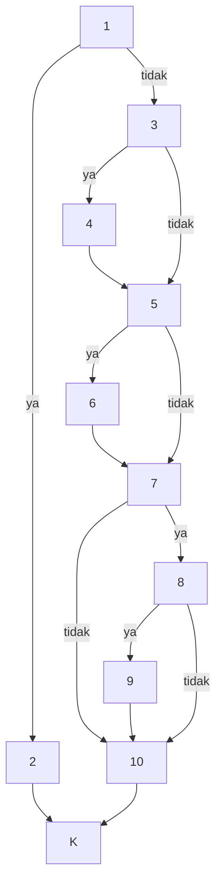

# Templat Basis Path

Basis path testing (McCabe): gambar graf alir sebuah fungsi, hitung kompleksitas
siklomatik **V(G)**, cari V(G) jalur yang saling bebas, lalu buat satu kasus uji
per jalur. Hasilnya: setiap pernyataan dan setiap cabang pasti terlewati minimal
sekali.

Contoh di bawah sengaja memakai fungsi **di luar MARSPEC** supaya tidak ada
anggota yang mendapat jawaban gratis. Ikuti langkahnya pada fungsi bagianmu.

## Contoh lengkap

```python
def biaya_kirim(berat_kg, ekspres, jarak_km):
    if berat_kg <= 0:                          # P1
        raise ValueError("berat harus > 0")
    biaya = 10_000
    if berat_kg > 5:                           # P2
        biaya += (berat_kg - 5) * 2_000
    if ekspres:                                # P3
        biaya *= 2
    if jarak_km > 100 and not ekspres:         # P4a, P4b
        biaya += 15_000
    return biaya
```

### Langkah 1 — Simpul

Pernyataan berurutan digabung ke satu simpul. **Kondisi majemuk dipecah**: setiap
operan `and`/`or` jadi simpul keputusan sendiri, karena Python mengevaluasinya
terpisah (short-circuit).

| Simpul | Isi |
|---|---|
| 1 | `if berat_kg <= 0` |
| 2 | `raise ValueError` |
| 3 | `biaya = 10_000` ; `if berat_kg > 5` |
| 4 | `biaya += (berat_kg - 5) * 2_000` |
| 5 | `if ekspres` |
| 6 | `biaya *= 2` |
| 7 | `if jarak_km > 100` |
| 8 | `if not ekspres` |
| 9 | `biaya += 15_000` |
| 10 | `return biaya` |
| K | keluar |

### Langkah 2 — Graf alir



(GitHub menggambar blok `mermaid` otomatis. Di laporan boleh digambar tangan.)

### Langkah 3 — V(G), dihitung dua cara supaya saling memeriksa

- **E − N + 2** = 15 sisi − 11 simpul + 2 = **6**
- **P + 1** = 5 simpul keputusan (1, 3, 5, 7, 8) + 1 = **6**

Kalau dua cara ini tidak sama, graf alirnya salah gambar.

### Langkah 4 — Jalur independen (metode jalur dasar)

Pilih satu jalur dasar yang wajar, lalu **balik satu keputusan per jalur baru**.

| Jalur | Urutan simpul | Keputusan yang dibalik | Sisi baru |
|---|---|---|---|
| J1 (dasar) | 1-3-5-7-10-K | — | |
| J2 | 1-2-K | P1 | 1→2, 2→K |
| J3 | 1-3-4-5-7-10-K | P2 | 3→4, 4→5 |
| J4 | 1-3-5-6-7-10-K | P3 | 5→6, 6→7 |
| J5 | 1-3-5-7-8-9-10-K | P4a | 7→8, 8→9, 9→10 |
| J6 | 1-3-5-**6**-7-8-10-K | P4b | 8→10 |

**Pelajaran J6.** Membalik P4b langsung dari J5 memberi 1-3-5-7-8-10-K, yang
**mustahil** dilalui: lewat 5 tanpa ke 6 berarti `ekspres` salah, tapi lewat 8 ke
10 butuh `not ekspres` salah, yaitu `ekspres` benar. Dua keputusan memeriksa
variabel yang sama, jadi tidak bebas. Jalur penggantinya harus ikut lewat 6.
Di laporan, **tulis jalur mustahil beserta alasannya**: itu nilai tambah, bukan
kesalahan.

Setiap jalur menambah minimal satu sisi yang belum pernah dilalui jalur sebelumnya:
itulah arti "independen".

### Langkah 5 — Kasus uji

| Jalur | berat_kg | ekspres | jarak_km | Hasil yang diharapkan | Perhitungan |
|---|---|---|---|---|---|
| J1 | 3 | False | 50 | 10 000 | dasar |
| J2 | 0 | False | 50 | `ValueError` | berat ≤ 0 |
| J3 | 8 | False | 50 | 16 000 | 10 000 + 3 × 2 000 |
| J4 | 3 | True | 50 | 20 000 | 10 000 × 2 |
| J5 | 3 | False | 150 | 25 000 | 10 000 + 15 000 |
| J6 | 3 | True | 150 | 20 000 | ekspres dikali 2, tanpa biaya jarak |

### Langkah 6 — Kode uji

```python
@pytest.mark.parametrize("berat, ekspres, jarak, harapan", [
    (3, False,  50, 10_000),   # J1
    (8, False,  50, 16_000),   # J3
    (3, True,   50, 20_000),   # J4
    (3, False, 150, 25_000),   # J5
    (3, True,  150, 20_000),   # J6
])
def test_wb_basis_path_biaya_kirim(berat, ekspres, jarak, harapan):
    assert biaya_kirim(berat, ekspres, jarak) == harapan


def test_wb_basis_path_biaya_kirim_J2():
    with pytest.raises(ValueError):
        biaya_kirim(0, False, 50)
```

### Kalau ada perulangan

`for`/`while` adalah simpul keputusan juga ("masih ada elemen?" ya/tidak).
Basis path saja tidak cukup untuk perulangan, jadi **tambahkan uji perulangan**:
jalankan perulangan 0 kali, 1 kali, maksimum, dan lebih dari maksimum (kalau ada
batas seperti `min(n, 6)`). Sering kali jalur "0 kali" mustahil karena syarat di
atasnya (misal daftar kosong sudah ditolak lebih dulu): tulis itu sebagai jalur
mustahil.

---

## Templat kosong

### Fungsi: `[nama_fungsi]` · Berkas: `marspec/[berkas].py` baris [a]–[b] · Penguji: [nama]

**Simpul**

| Simpul | Isi (baris kode) |
|---|---|
| 1 | |

**Graf alir**: [gambar / mermaid]

**V(G)**: E − N + 2 = [ ] − [ ] + 2 = [ ] · P + 1 = [ ] + 1 = [ ]

**Jalur independen**

| Jalur | Urutan simpul | Keputusan dibalik | Sisi baru | Mungkin dilalui? (kalau tidak, kenapa) |
|---|---|---|---|---|
| J1 | | — | | |

**Kasus uji**

| Jalur | Masukan | Hasil yang diharapkan | Fungsi uji | Status |
|---|---|---|---|---|
| J1 | | | | |

**Cakupan cabang** fungsi ini: sebelum [ ]% → sesudah [ ]%. Cabang yang tersisa: [daftar + alasan].
